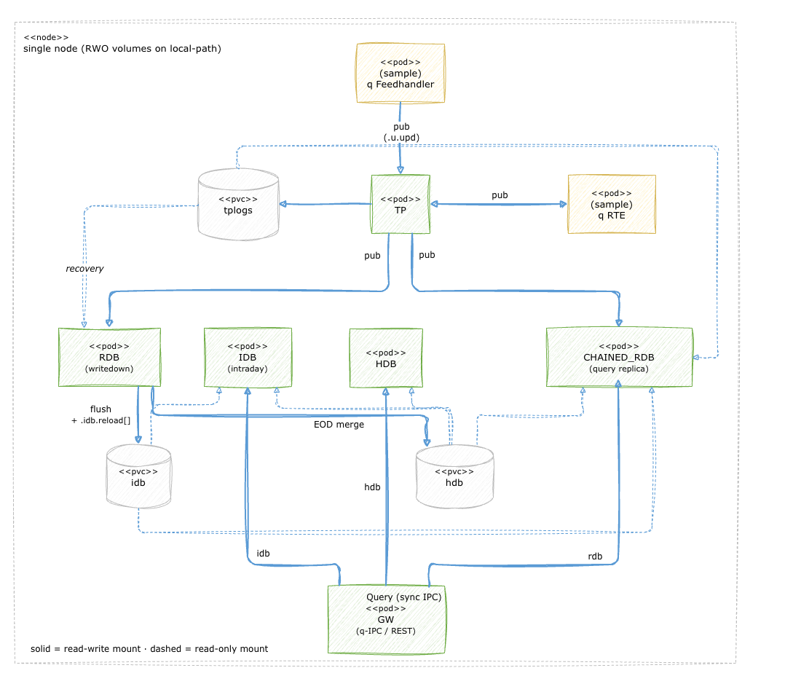

# tick-x on Kubernetes (single node)



This runs the tick-x reference architecture (eight q processes: TP, IDB, HDB, RDB (writedown), CHAINED_RDB, FH, RTE and GW) on Kubernetes, **on one node**. Each process is a pod. The directories they share (the TP log, the intraday and historical databases) are ordinary volumes on that node's local disk, shared the way processes on one server share directories. There is no distributed storage, no operator and no cluster-wide state.

If one well-provisioned server is how you run kdb+ today, this is the same thing, packaged so a platform team can run it where Kubernetes is the standard.

**What you get**
- The same processes with the same command lines as bare metal and the [Docker Compose project](../docker/README.md).
- Data that survives pod restarts and `helm uninstall`.
- Everyday operation with a handful of `kubectl` commands (see [Day to day](#day-to-day)).

**What you do not get**
- High availability. If the node is lost you have lost the server, exactly as on bare metal. There is no replication.
- Scale-out. Every process runs once.
- Anything exposed outside the cluster. All services are internal; you reach the gateway with `kubectl port-forward`. q IPC is unauthenticated, as on bare metal.
- CPU or memory limits (the compose project has none either). Add them in `templates/deployment.yaml` if your platform requires them.

New to Kubernetes? The words are explained in the [glossary](#glossary).

## Quick start

You need a Kubernetes cluster with a default StorageClass, `kubectl`, [Helm](https://helm.sh) 3 or later, a KX licence, and the container image (next section). Any cluster works; see [Multi-node clusters](#multi-node-clusters).

```sh
# 1. Build the image (prerequisites are in ../docker/README.md), then get it onto the cluster (next section)
cd tick-x/docker && docker compose build

# 2. A namespace for this stack, and your licence as a Secret
kubectl create namespace tick-x
kubectl -n tick-x create secret generic kdbx-licence --from-file=kc.lic=$HOME/.kx/kc.lic

# 3. Install and wait until every pod is Ready (about a minute)
cd ../helm
helm install tick-x . -n tick-x
kubectl -n tick-x wait --for=condition=Ready pod --all --timeout=240s

# 4. Query the gateway
kubectl -n tick-x port-forward svc/gw 5013:5013 &
curl localhost:5013/energy/idb
```

Use one namespace per stack. Object names are not prefixed with the release name (so `tp:5010` works as it does in compose), which means two stacks in one namespace collide, including tick and tick-x.

The licence Secret is mounted read-only as a directory at `/run/secrets/kx`, where the image looks for it (`QLIC`). To use a Secret with another name, set `licence.existingSecret` in `values.yaml`.

### Getting the image onto the cluster

The chart uses the image `kdbx-tick-reference:tick-x` and never pulls it. Load it into your cluster, once per node:

| Cluster | Command |
| --- | --- |
| Docker Desktop, OrbStack | Nothing: the cluster uses your local Docker images |
| Colima with Kubernetes | Build in the same Colima profile that runs Kubernetes (`docker --context colima-<profile>`), or `docker save kdbx-tick-reference:tick-x \| docker --context colima-<profile> load` |
| k3d | `k3d image import kdbx-tick-reference:tick-x -c <cluster>` |
| kind | `kind load docker-image kdbx-tick-reference:tick-x` |
| k3s on Linux | `docker save kdbx-tick-reference:tick-x \| sudo k3s ctr images import -` |
| Any remote cluster | Push it to a registry, then set `image.repository`, `image.tag` and `image.pullSecrets` in `values.yaml` |

Tested here: Colima with k3s, and a two-node k3d cluster. The other rows follow each tool's documentation and have not been run. If a pod shows `ImagePullBackOff`, the image is not on the node that pod landed on, or Kubernetes deleted it: a node removes unused images when its disk is over 85% full, so load the image just before you install.

## How it works

- **One pod per process.** Each entry under `processes:` in [values.yaml](./values.yaml) becomes a Deployment (one pod) and a Service. The Service has the process's lower-case name (`tp`, `rdb`, `hdb`), so a process reaches another one at `tp:5010`.
- **Command lines.** `script` and `args` are the q command line. `connects: {tpPort: tp}` adds `-tpPort tp:5010` to it. The port comes from `tp`'s own `port:` entry, so each port is defined once. q reads these flags itself and knows nothing about Helm or Kubernetes.
- **Startup order.** A pod does not start its q process until every process it connects to passes its health check (an init container runs the same `healthcheck.q` used by the compose project).
- **Health.** A pod is Ready when its health check passes. A pod that is not Ready is removed from its Service, so nothing can connect to it until it recovers. Kubernetes never restarts a pod for a failing health check, only if q exits.
- **Volumes.**
| Volume | Written by | Read (read-only) by |
| --- | --- | --- |
| `tplogs` | TP | RDB, CHAINED_RDB |
| `hdb` | RDB (end-of-day merge) | IDB, HDB, CHAINED_RDB |
| `idb` | RDB (every flush) | IDB, CHAINED_RDB |

Each volume has exactly one writer. The whole `idb` directory is mounted, never just `today/`, because the RDB deletes `today/` at end of day.

- **Everything on one node.** The pods share files on one node's disk, so Kubernetes must run them all on the same node. The chart asks for that (pod affinity on the node name): the first pod lands anywhere, the rest follow it. To choose the node, set `nodeSelector` in `values.yaml`, for example `{kubernetes.io/hostname: mynode}`.

### Trying the intraday flush quickly

The RDB flushes to the IDB every 5 minutes by default. To see it sooner, change `-flushIntvMin` from `"5"` to `"1"` under `rdb` in `values.yaml`, run `helm upgrade tick-x . -n tick-x`, speed up the feedhandler (see [Retune the feedhandler timer](#retune-the-feedhandler-timer)), then query `curl localhost:5013/energy/idb`.

## Data

Each volume is one directory on the node's disk. With the default k3s `local-path` StorageClass it is `/var/lib/rancher/k3s/storage/pvc-<id>_<namespace>_<volume>` (on k3d and similar, inside the node container). Find it, and the node it lives on, with:

```sh
kubectl get pv -o custom-columns=VOLUME:.spec.claimRef.name,PATH:.spec.local.path
kubectl -n tick-x get pvc
```

You can `ls` it and back it up by copying it, like any directory. Other StorageClasses store data elsewhere.

| What you do | What happens to the data |
| --- | --- |
| A pod crashes or restarts | Kept. The RDB replays the TP log when it comes back. |
| `helm uninstall tick-x -n tick-x` | Kept. A later `helm install` reattaches the same volumes. |
| `kubectl -n tick-x delete pvc -l app.kubernetes.io/instance=tick-x` | **Deleted.** This is the equivalent of `docker compose down -v`. |
| The node is lost | Lost with the node, as with a server. Back up the directories if that matters. |

## Day to day

| Task | Command |
| --- | --- |
| See the processes | `kubectl -n tick-x get pods` |
| Read a process's log | `kubectl -n tick-x logs -f deploy/gw` (add `--previous` after a crash) |
| Open a q session in a pod | `kubectl -n tick-x exec -it deploy/tp -- q` |
| Restart one process | `kubectl -n tick-x rollout restart deploy/gw` |
| Stop everything, keep the data | `helm uninstall tick-x -n tick-x` |
| Start it again | `helm install tick-x . -n tick-x` |
| Change a setting | Copy `values.yaml`, edit the copy, then `helm upgrade tick-x . -n tick-x -f my-values.yaml`. Pods restart. |
| After changing q code | Rebuild the image, load it again, then `kubectl -n tick-x rollout restart deploy` |

Log files under `proclogs` are per pod and disappear when the pod restarts, so use `kubectl logs`. Every pod also logs to stdout. Do not use `--set` to change a list such as `args`: Helm replaces the entire list, not one entry. Edit a copy of the file instead.

`helm uninstall` stops all pods at once. The compose project stops them in reverse dependency order. For a tidy stop, run the manual end-of-day steps first (see [../docker/README.md](../docker/README.md)), using `kubectl exec` in place of `docker compose exec`.

### Retune the feedhandler timer

The equivalent of `fh-timer.sh`, without restarting the feedhandler:

```sh
printf '%s\n' 'fh:hopen `::5014; fh"\\t 1000";exit 0' | kubectl -n tick-x exec -i deploy/fh -- q
```

Use `\\t 0` to pause ingest.

### What the pod status means

| You see | Meaning | Look at |
| --- | --- | --- |
| `Init:0/1` | Waiting for a process it connects to to become healthy | `kubectl -n tick-x get pods` for the one that is not Ready |
| `Running`, `0/1` | q is up but its health check fails, e.g. it has lost the TP | `kubectl -n tick-x logs deploy/<name>` |
| `CrashLoopBackOff`, `Error` | q exited | `kubectl -n tick-x logs deploy/<name> --previous` |
| `ImagePullBackOff` | The image is not on this node | [Getting the image onto the cluster](#getting-the-image-onto-the-cluster) |
| `Pending` | Kubernetes cannot place it, often a volume tied to a different node | `kubectl -n tick-x describe pod <pod>` |

## Settings

Everything is in [values.yaml](./values.yaml): the image, licence Secret name, volume sizes, `storageClassName` (empty uses the cluster default), `nodeSelector`, shared environment variables, and each process's command line, port and mounts. `secondaries` is the `-s` value for every process.

## Multi-node clusters

Most clusters have several nodes, and the chart works on them, by running every pod of one stack on a single node. This is needed because node-local volumes (like `local-path`) belong to one node. Without it, Kubernetes can place `tplogs` on one node and `hdb` on another, and the RDB, which needs both, then never starts. The chart's pod affinity prevents that. It was tested on a two-node k3d cluster: an earlier version without the affinity left the RDB stuck `Pending` in 3 of 5 installs, and this version put all pods on one node in every install. Remember that the image must be present on whichever node is chosen, and that the data then lives on that node only.

## Glossary

- **Node**: a machine (or VM) in the cluster. Here, one node runs everything.
- **Pod**: one running process, in its own container. Here, one q process per pod.
- **Deployment**: keeps one pod running and restarts it if it exits.
- **Service**: a stable name (`tp`) and port that reaches a pod. This is what makes `tp:5010` work.
- **Volume / PVC (PersistentVolumeClaim)**: a named directory pods can mount. Here, a directory on the node's disk.
- **StorageClass**: the cluster's rule for creating volumes. The default one is used here.
- **Namespace**: a separate area of the cluster. One stack per namespace.
- **Secret**: a small piece of protected configuration. Here, your licence file.
- **Init container**: runs before the pod's main process. Here, it waits for dependencies.
- **Readiness probe**: the health check that decides whether a pod is Ready.
- **Helm chart / release**: the packaged files in this directory, and one installed copy of them.

## Appendix: how this maps to bare metal and Docker Compose

Nothing here is new to the q processes. The same command lines run in all three setups.

| | Bare metal ([README](../README.md)) | Docker Compose ([README](../docker/README.md)) | This chart |
| --- | --- | --- | --- |
| A process | `q tick-x/src/rdb.q -p 5011 …`, started by `scripts/startup.sh` | A service in `compose.yaml` | An entry under `processes:` |
| Command-line flags | As typed | `command:` | `script`, `args` and `connects` |
| Reaching another process | `localhost:5010` | `tp:5010` | `tp:5010` |
| Shared directories | Directories on the server | Named volumes | Volumes on the node |
| Read-only access | Directories shared by convention | `:ro` | `mounts: {hdb: ro}` |
| Start order | The order in the start script | `depends_on: service_healthy` | Init containers |
| Health check | Your own monitoring | `healthcheck:` | Readiness probe, same `healthcheck.q` |
| Restart on exit | Your supervisor | `restart: on-failure` | Deployment |
| Licence | `QLIC` directory | Licence directory mounted read-only | Secret mounted read-only |
| Logs | Log files | `docker compose logs` | `kubectl logs` |
| Stop, keep data | Stop the processes | `docker compose down` | `helm uninstall` |
| Stop, delete data | Delete the directories | `docker compose down -v` | `kubectl delete pvc -l …` |
